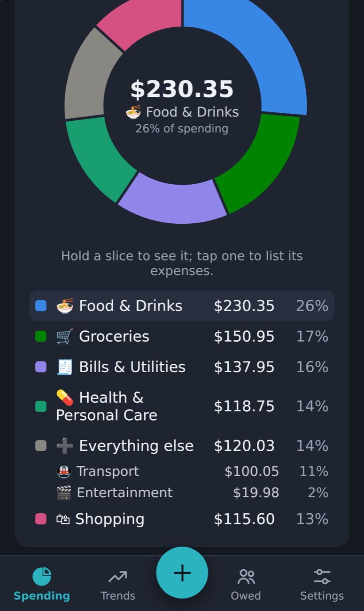
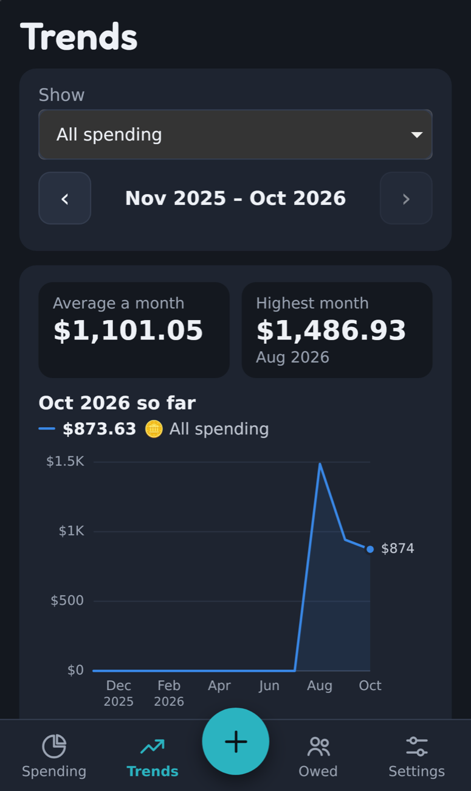
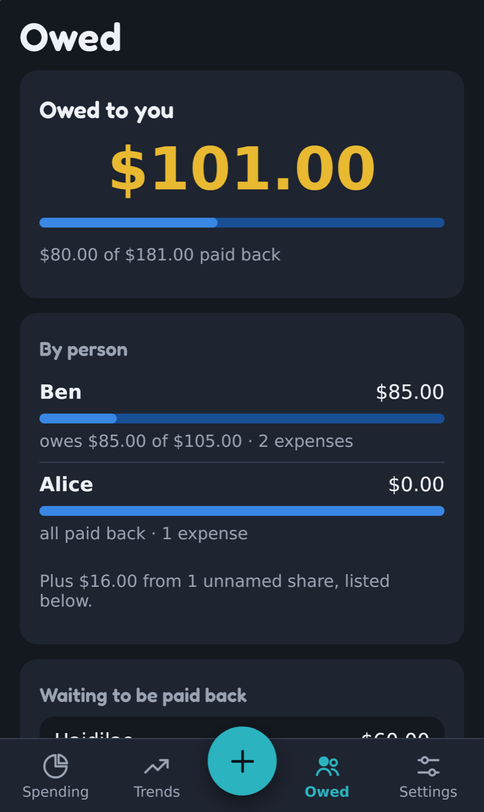

# MagPie

Spending tracker PWA. Maggie the magpie sorts your shiny coins into pie slices.

Local-first: everything lives in your browser's IndexedDB. Nothing is uploaded, and there is no backend or API key.

<p align="center">
  
  
  
</p>
<p align="center"><sub>iPhone 15, with made-up demo data. Fresh screenshots of every screen are taken on each push (see <a href="#screenshots">Screenshots</a>).</sub></p>

- **Spending:** by day, month or year, per card, as bars or a pie. Hold a slice to see it in the middle; tap a slice,
  bar or legend row to list just that category.
- **Trends:** monthly spending over 12 months, in total, one line per category, or for one category.
- **Owed:** split an expense with friends, named or not. Only your share counts as your spending; what others owe
  you is tracked separately, with full or part repayments.
- **+ (centre of the tab bar):** add an expense, or import a bank statement PDF (read on your device) or a
  Claude-made import for anything MagPie can't read.
- **Settings:** accounts, the merchants MagPie has learned, backups to move everything to another browser or device,
  and the Guide.
- **Guide:** how to use each of the above. Its button and field names are checked against the app by
  `src/features/guide/guide.test.ts`, so rename a button there too, or the test fails.

## Design review and roadmap

The [MagPie UX Review](https://claude.ai/artifact/T3pGtAW5kP8N87EqDSLczk) has 27 findings pinned on the app's screens,
a before-and-after sketch of the Spending screen, and the build plan:

| Phase | What changes |
|---|---|
| 0 · See what we ship | Screenshots of every screen on three phones, taken on every push (see [Screenshots](#screenshots)) |
| 1 · Navigation and home | A centre + tab bar, Settings, screen titles, a compact Spending screen, tap a category to filter, 44pt taps |
| 2 · Safer import | A faster import review, and Undo instead of confirmation pop-ups |
| 3 · Owed and Trends | Per-person view, reminders with your PayNow number, one row per category in Trends |
| 4 · Yours and polished | Custom categories, backup reminders, consistent wording and visual polish |

## Importing a statement

**Choose PDF statement** reads the PDF's text on your device with pdf.js. It's built for the POSB/DBS and HSBC
layouts: any line that starts with a date ("07 AUG", or HSBC's post and transaction dates) and has an amount after
the description is a transaction. Card payments are skipped by default. A password-protected PDF asks for its
password. A scanned or flattened PDF (no text layer) can't be read locally; use the Claude route for those.

**Or let Claude read it:**

1. **Copy prompt.** The prompt contains MagPie's import format plus your categories and accounts.
2. Paste it into a Claude chat with your statement attached, and copy the JSON it replies with.
3. **Paste the JSON** into MagPie.

Either way you get an editable draft: fix categories, accounts and skipped rows, then confirm. The draft checks the
rows against the statement's own figures (its purchase total, or previous and new balance), and flags rows already
in MagPie. Picking a category for one row applies it to every row of that merchant, and MagPie remembers it.

Categories come from, in order: merchants you've taught MagPie, then Claude's guess (Claude route only), then the
built-in starter dictionary (`src/domain/dictionary.ts`) of common Singapore merchants.

> The Claude route sends your statement to Claude. Redact card numbers, your name and your address first.
> Black boxes drawn over a PDF often leave the text underneath readable. Check by selecting the text, or screenshot the transactions instead.

## Charts

Colours come from the dataviz skill's validated categorical palette (`src/domain/palette.ts`), checked against the
panel surface for colour-blind and normal-vision separation. There are eight hues for eight categories, plus grey for
"Other". The pie shows at most six slices and orders them so hues that blur together never touch.

## Development

```sh
npm install
npm run dev     # http://localhost:5173
npm test
npm run build
npm run icons   # re-render the PNG icons after editing public/icon.svg
```

`samples/` is gitignored. Put real statements and their `*.magpie.json` imports there. `npm test` checks that every
`samples/*.magpie.json` reconciles, and that every `samples/*.pdf` either reads and reconciles locally or is reported as
having no text. Never commit them.

### Screenshots

Every push runs `.github/workflows/screenshots.yml`. It photographs every screen on an iPhone SE, an iPhone 15 and a
Pixel 7, using made-up demo data (`scripts/demo-data.mjs`) restored through Settings, and fails if a page throws an
error. Download them from the run's **Artifacts** section. To take them on your own machine:

```sh
npm install --no-save playwright@1.52.0 && npx playwright install chromium webkit
npm run build && npm run screenshots   # writes screenshots/<phone>/*.png
```

To explore the app with the demo data yourself, restore a backup made by `demoBackup()` in `scripts/demo-data.mjs`.
