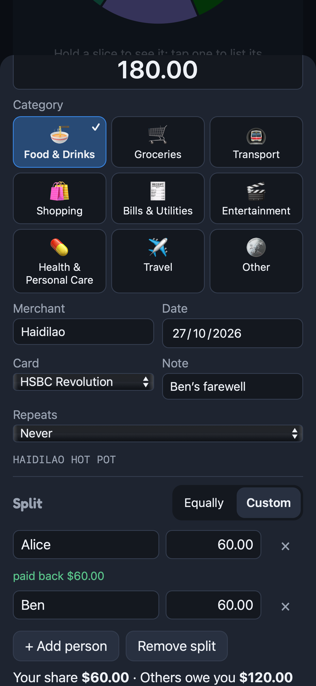
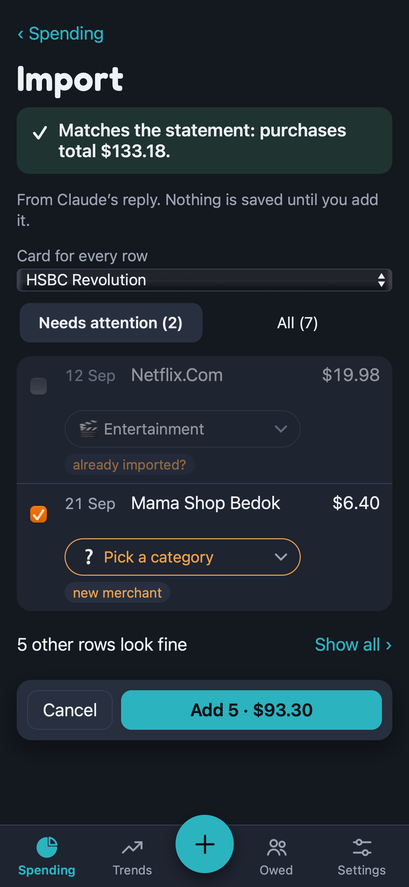
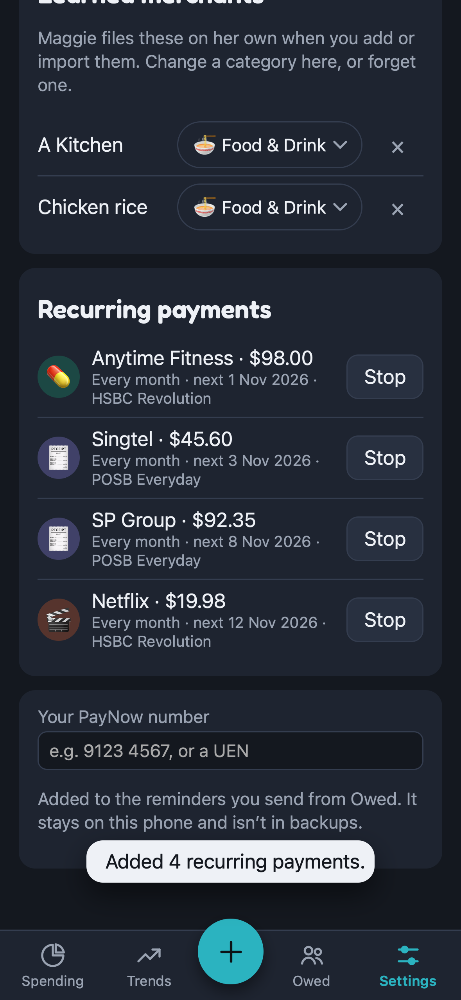

<p align="center">&nbsp;&nbsp;</p>

# MagPie

Spending tracker PWA. Maggie the magpie sorts your shiny coins into pie slices.

Live at https://yewmeng28.github.io/magpie/ (deployed by GitHub Actions on every push to `main`). Add it to your Home
Screen to use it like an app.

Local-first: everything lives in your browser's IndexedDB. Nothing is uploaded, and there is no backend or API key.

<table>
  <tr>
    <td align="center" width="33%"><br><sub><b>See where it goes</b><br>Hold a slice, tap to filter</sub></td>
    <td align="center" width="33%"><br><sub><b>Split a bill</b><br>Only your share counts</sub></td>
    <td align="center" width="33%"><br><sub><b>Know who owes you</b><br>Full or part repayments</sub></td>
  </tr>
  <tr>
    <td align="center"><br><sub><b>Import a statement</b><br>Read on your phone, checked against its totals</sub></td>
    <td align="center"><br><sub><b>Repeat the bills</b><br>Spotted for you, added when due</sub></td>
    <td align="center"><br><sub><b>Spot your habits</b><br>12 months at a glance</sub></td>
  </tr>
</table>

<p align="center"><sub>iPhone 16 · made-up demo data · refreshed with <code>npm run screenshots:readme</code></sub></p>

## What it does

- **Spending:** by day, month or year, per card, as bars or a pie. Hold a slice to see it in the middle; tap a slice,
  bar or legend row to list just that category.
- **Trends:** monthly spending over 12 months, in total or for one category, and this month against last. "Each
  category" gives every category a row with a sparkline and how this month compares with its usual month.
- **Recurring payments:** set an expense to repeat every week, month or year and MagPie adds it when due. It also
  spots bills that already repeat (same merchant, amount and date, month after month) and offers to set them up.
- **Owed:** split an expense with friends, named or not. Only your share counts as your spending; what others owe
  you is tracked separately. Tap a person to see everything they owe, record a payment (it pays off their oldest bills
  first), mark it all paid, or send them a reminder with your PayNow number.
- **+ (centre of the tab bar):** add an expense, or import a bank statement PDF (read on your device) or a
  Claude-made import for anything MagPie can't read.
- **Settings:** backups (with when you last backed up; on iPhone they go out through the share sheet, to Files or
  AirDrop), your own categories (name, emoji, one of eight chart-safe colours, order, hide or delete), cards, the
  merchants Maggie has learned (change their category in place), recurring payments, your PayNow number (kept on this
  phone, not in backups), recent imports, and the Guide.
- **Get started:** a first-launch card with three steps that tick off by themselves. Once it's done or hidden, Spending
  reminds you to back up once a month.
- **Guide:** how to use each of the above. Its button and field names are checked against the app by
  `src/features/guide/guide.test.ts`, so rename a button there too, or the test fails.

## Design review and roadmap

The [MagPie UX Review](https://claude.ai/artifact/T3pGtAW5kP8N87EqDSLczk) has 27 findings pinned on the app's screens,
a before-and-after sketch of the Spending screen, and the build plan:

| Phase | What changes | Status |
|---|---|---|
| 0 · See what we ship | Screenshots of every screen on three phones, taken on every push (see [Screenshots](#screenshots)) | Done |
| 1 · Navigation and home | A centre + tab bar, Settings, screen titles, a compact Spending screen, tap a category to filter, 44pt taps | Done |
| 2 · Safer import | A faster import review, and Undo instead of confirmation pop-ups | Done |
| 3 · Owed and Trends | Per-person view, reminders with your PayNow number, one row per category in Trends | Done |
| 4 · Yours and polished | Custom categories, backup reminders, Get started, consistent wording, tap feedback, a type scale, flatter screens | Done |

## Importing a statement

**Choose PDF statement** reads the PDF's text on your device with pdf.js. It's built for the POSB/DBS and HSBC
layouts: any line that starts with a date ("07 AUG", or HSBC's post and transaction dates) and has an amount after
the description is a transaction. Card payments are skipped by default. A password-protected PDF asks for its
password. A scanned or flattened PDF (no text layer) can't be read locally; use the Claude route for those.

**Or let Claude read it:**

1. **Copy prompt.** The prompt contains MagPie's import format plus your categories and accounts.
2. Paste it into a Claude chat with your statement attached, and copy the JSON it replies with.
3. **Paste the JSON** into MagPie.

Either way you get an editable draft: fix categories, accounts and skipped rows, then confirm. The draft checks the
rows against the statement's own figures (its purchase total, or previous and new balance), and flags rows already
in MagPie. Picking a category for one row applies it to every row of that merchant, and MagPie remembers it.

Categories come from, in order: merchants you've taught MagPie, then Claude's guess (Claude route only), then the
built-in starter dictionary (`src/domain/dictionary.ts`) of common Singapore merchants.

> The Claude route sends your statement to Claude. Redact card numbers, your name and your address first.
> Black boxes drawn over a PDF often leave the text underneath readable. Check by selecting the text, or screenshot the transactions instead.

## Charts

Colours come from the dataviz skill's validated categorical palette (`src/domain/palette.ts`), checked against the
panel surface for colour-blind and normal-vision separation. There are eight hues for eight categories, plus grey for
"Other". The pie shows at most six slices and orders them so hues that blur together never touch.

## Development

```sh
npm install
npm run dev     # http://localhost:5173
npm test
npm run build
npm run icons   # re-render the PNG icons after editing public/icon-v4.svg (see docs/brand)
```

`samples/` is gitignored. Put real statements and their `*.magpie.json` imports there. `npm test` checks that every
`samples/*.magpie.json` reconciles, and that every `samples/*.pdf` either reads and reconciles locally or is reported as
having no text. Never commit them.

### Screenshots

Every push runs `.github/workflows/screenshots.yml`. It photographs every screen on an iPhone SE, an iPhone 16 and a
Pixel 7, using made-up demo data (`scripts/demo-data.mjs`) restored through Settings, and fails if a page throws an
error. To take them on your own machine:

```sh
npm run screenshots:setup    # once: installs Playwright and its browsers
npm run screenshots          # builds, then writes screenshots/<phone>/*.png
npm run screenshots:readme   # the same, and refreshes the README images in docs/screenshots/
```

To explore the app with the demo data yourself, restore a backup made by `demoBackup()` in `scripts/demo-data.mjs`.
