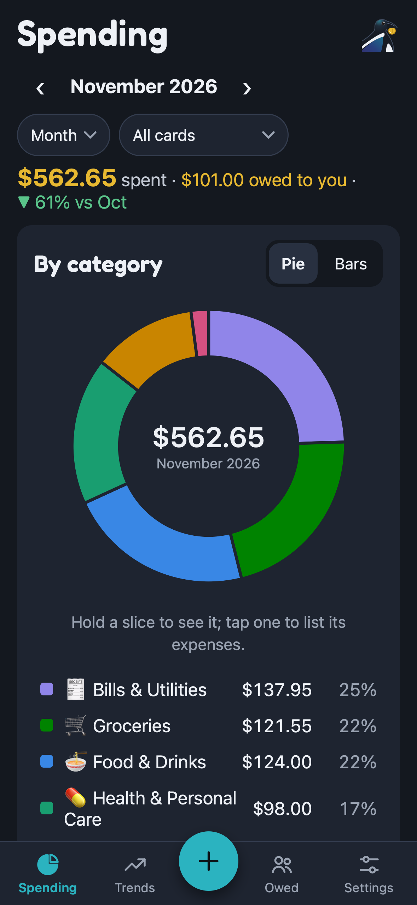
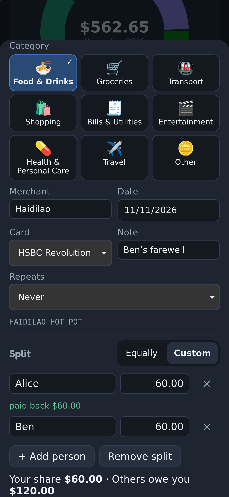
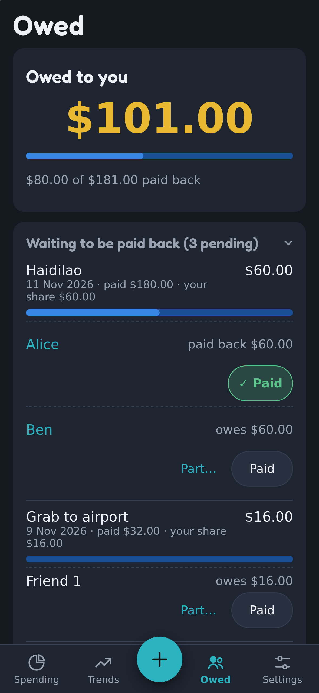
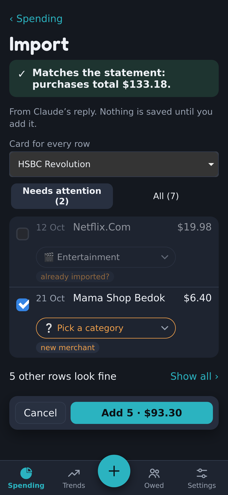
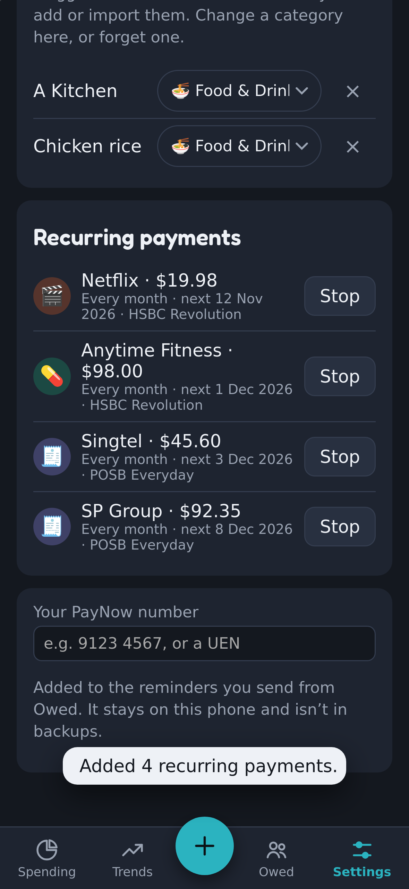
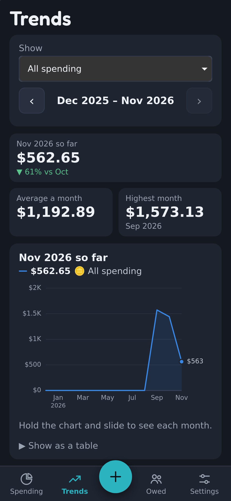
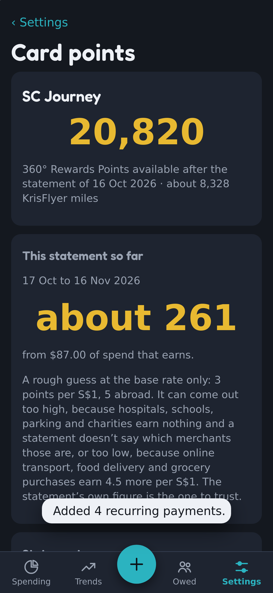
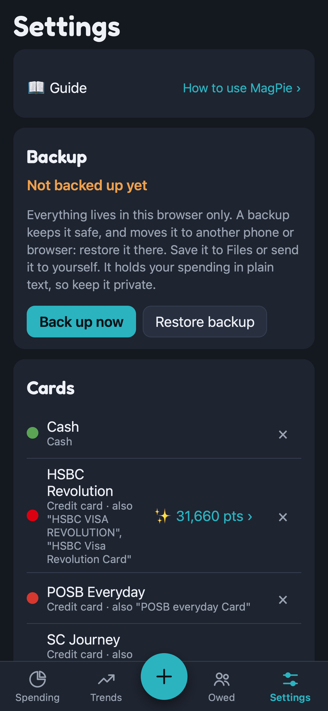
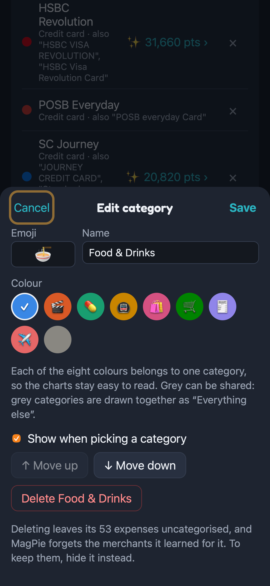

<p align="center">&nbsp;&nbsp;</p>

# MagPie

Spending tracker PWA. Maggie the magpie sorts your shiny coins into pie slices.

Live at https://yewmeng28.github.io/magpie/ (deployed by GitHub Actions on every push to `main`). Add it to your Home
Screen to use it like an app.

Local-first: everything lives in your browser's IndexedDB. Nothing is uploaded, and there is no backend or API key.

<table>
  <tr>
    <td align="center" width="33%"><br><sub><b>See where it goes</b><br>Hold a slice, tap to filter</sub></td>
    <td align="center" width="33%"><br><sub><b>Split a bill</b><br>Only your share counts</sub></td>
    <td align="center" width="33%"><br><sub><b>Know who owes you</b><br>Full or part repayments</sub></td>
  </tr>
  <tr>
    <td align="center"><br><sub><b>Import a statement</b><br>Read on your phone, checked against its totals</sub></td>
    <td align="center"><br><sub><b>Repeat the bills</b><br>Spotted for you, added when due</sub></td>
    <td align="center"><br><sub><b>Spot your habits</b><br>12 months at a glance</sub></td>
  </tr>
  <tr>
    <td align="center"><br><sub><b>Track card points</b><br>Read from your statements</sub></td>
    <td align="center"><br><sub><b>Your cards first</b><br>Points beside each card</sub></td>
    <td align="center"><br><sub><b>Make it yours</b><br>Your own categories</sub></td>
  </tr>
</table>

<p align="center"><sub>iPhone 16 · made-up demo data · refreshed with <code>npm run screenshots:readme</code></sub></p>

## What it does

- **Spending:** by day, month or year, per card, as bars or a pie. Hold a slice to see it in the middle; tap a slice,
  bar or legend row to list just that category.
- **Trends:** monthly spending over 12 months, in total or for one category, and this month against last. "Each
  category" gives every category a row with a sparkline and how this month compares with its usual month.
- **Recurring payments:** set an expense to repeat every week, month or year and MagPie adds it when due. It also
  spots bills that already repeat (same merchant, amount and date, month after month) and offers to set them up.
- **Owed:** split an expense with friends, named or not. Only your share counts as your spending; what others owe
  you is tracked separately. "Waiting to be paid back" comes first (with how many are pending, or "Everyone has paid you
  back" when none), then "By person", which folds away and opens only while someone still owes you. Tap a person to see everything they owe, record a payment (it pays
  off their oldest bills first), mark it all paid, or send them a reminder with your PayNow number.
- **+ (centre of the tab bar):** add an expense, or import a bank statement (a PDF, or a screenshot or photo of one,
  read on your device) or a Claude-made import for anything MagPie can't read. See [Importing a
  statement](#importing-a-statement).
- **Card points:** reads the points a Standard Chartered or HSBC statement shows and keeps them per card. A card's
  balance sits beside it in Settings → Cards, and a points row appears in Spending when you filter to that card. See
  [Card points](#card-points).
- **Settings:** the Guide, backups (with when you last backed up; on iPhone they go out through the share sheet, to
  Files or AirDrop), your cards (with their points), your own categories (a collapsible list: name, emoji, one of
  eight chart-safe colours, order, hide or delete), the merchants Maggie has learned (change their category in
  place), recurring payments, your PayNow number (kept on this phone, not in backups), and recent imports.
- **Get started:** a first-launch card with three steps that tick off by themselves. Once it's done or hidden, Spending
  reminds you to back up once a month.
- **Guide:** how to use each of the above. Its button and field names are checked against the app by
  `src/features/guide/guide.test.ts`, so rename a button there too, or the test fails.

## Design review and roadmap

The [MagPie UX Review](https://claude.ai/artifact/T3pGtAW5kP8N87EqDSLczk) has 27 findings pinned on the app's screens,
a before-and-after sketch of the Spending screen, and the build plan:

| Phase | What changes | Status |
|---|---|---|
| 0 · See what we ship | Screenshots of every screen on three phones, taken on every push (see [Screenshots](#screenshots)) | Done |
| 1 · Navigation and home | A centre + tab bar, Settings, screen titles, a compact Spending screen, tap a category to filter, 44pt taps | Done |
| 2 · Safer import | A faster import review, and Undo instead of confirmation pop-ups | Done |
| 3 · Owed and Trends | Per-person view, reminders with your PayNow number, one row per category in Trends | Done |
| 4 · Yours and polished | Custom categories, backup reminders, Get started, consistent wording, tap feedback, a type scale, flatter screens | Done |

## Importing a statement

Tap the + then **Import a statement**, then **Choose statement** and pick a PDF, or a screenshot or photo of one.
Everything is read on your device with pdf.js (and tesseract.js for scans and images); nothing is uploaded. A
password-protected PDF asks for its password.

### What it can read

| Statement | Read as | Checked against |
|---|---|---|
| POSB/DBS credit card | text PDF | previous and new balance |
| HSBC credit card | a scan (tested), or a text PDF | its purchases total, or previous and new balance |
| Standard Chartered credit card | text PDF | previous and new balance; also its points |
| POSB/DBS savings and Multiplier account (consolidated statement) | text PDF | opening and closing balance |
| HSBC savings account (composite statement) | a scan (tested), or a text PDF | opening and closing balance |
| OCBC 360 account | a screenshot (tested); a PDF is read the same way but hasn't been tried | opening and closing balance, when printed |

Card statements are read by one rule: any line that starts with a date ("07 AUG", or HSBC's post and transaction
dates) and has an amount after the description is a transaction. Card payments are skipped by default. A purchase
abroad is flagged from the line of original currency under it.

Account statements work differently, because a deposit and a withdrawal print the same way:

- **DBS/POSB:** each row's direction comes from how the running balance moved, and wrapped lines under a row (the
  payee, the reference) are folded into it.
- **HSBC and OCBC:** a row starts with its date and its amount can be on any of its lines. Direction comes from the
  running balance when the statement prints one, otherwise from the Withdrawal or Deposit column the amount sits
  under. A date with no year (OCBC) is placed in the latest year that doesn't put it in the future.
- **Money in is not spending.** Deposits are listed but unticked, and so are a card's bill payments and PayLah!
  top-ups (money out that the card's own statement already carries). Tick any you do want counted.

Any statement from another bank is tried the same way as a card statement. If it can't be read, or no row matches, you
get a message and the Claude route below.

### Checking the result

The review screen shows a banner: **Matches the statement** when the rows add up to the statement's own totals, or
**Doesn't match** with the difference. A mismatch means a row was missed or misread, so look over the rows. In the
browser console, "lines with an amount that were not read as transactions" lists what the parser skipped. A screenshot
with no balance column (a cropped one) has nothing to check against, so no banner shows: look over its rows.

### Scans, screenshots and photos

A scanned PDF (no text layer) or an image is read with on-device OCR: tesseract.js at up to 4x resolution (small
images are enlarged to about 2400 px wide), in single-column layout. OCR can drop a decimal point or misread a sign, so
MagPie repairs the common slips (`2570` for `25.70`, `0ct` for `Oct`) and leans on the banner above. The OCR engine
and its English language data download once on first use and are then cached, so the first scan needs a connection;
the file itself never leaves the device.

### Card points

A Standard Chartered statement carries its card's points, and so does an HSBC one. MagPie reads them, checks that the
figures add up (previous + earned − used ± adjustments = available) and saves them with the card when you add the
import. The card must be one of your Cards in Settings; "SC Journey" is added for you, and the review screen says when
a statement's card isn't one of yours. Where to find them:

- **Settings → Cards:** each credit card with points shows its balance ("✨ 102,399 pts ›"); tap it for that card's
  points. A card with a known programme but nothing imported yet shows "Points ›".
- **Spending:** filter to one card and a "✨ points" row appears under the filters; tap it for the detail.
- **After an import:** when the statement's points were saved, the message at the bottom has a **View** button next to
  Undo.

The points screen opens on that card and goes back to where you came from. It shows the latest balance (and, for SC
Journey, the KrisFlyer miles it is worth at 2.5 points a mile), what each statement awarded, and a warning on any
statement that doesn't start where the one before it ended (a misread figure, or a statement missing). Importing a
statement again replaces its points; the × next to one removes it, with Undo.

For the **SC Journey** card it also guesses what the open statement has earned so far, from the card's terms: 3 points
per S$1, and 5 per S$1 in a foreign currency, leaving out what a description shows earns nothing (AXS, insurance,
fees, instalments, recurring payments). The guess can't see merchant category codes, so it misses the 4.5 bonus on
online transport, food delivery and groceries, and can't tell which merchants (hospitals, schools, parking,
charities) earn nothing. It can come out too high or too low: treat it as a rough guide and the statement's figure as
the truth. **HSBC Revolution** is tracked from its statements only, because its earning rules aren't built in: its
statements work out to about 1 point per S$1, which the screen shows as a rate.

**Or let Claude read it:**

1. **Copy prompt.** The prompt contains MagPie's import format plus your categories and accounts.
2. Paste it into a Claude chat with your statement attached, and copy the JSON it replies with.
3. **Paste the JSON** into MagPie.

Either way you get an editable draft: fix categories, accounts and skipped rows, then confirm. The draft checks the
rows against the statement's own figures (its purchase total, or previous and new balance), and flags rows already
in MagPie. Picking a category for one row applies it to every row of that merchant, and MagPie remembers it.

Categories come from, in order: merchants you've taught MagPie, then Claude's guess (Claude route only), then the
built-in starter dictionary (`src/domain/dictionary.ts`) of common Singapore merchants.

> The Claude route sends your statement to Claude. Redact card numbers, your name and your address first.
> Black boxes drawn over a PDF often leave the text underneath readable. Check by selecting the text, or screenshot the transactions instead.

## Charts

Colours come from the dataviz skill's validated categorical palette (`src/domain/palette.ts`), checked against the
panel surface for colour-blind and normal-vision separation. There are eight hues for eight categories, plus grey for
"Other". The pie shows at most six slices and orders them so hues that blur together never touch.

## Development

```sh
npm install
npm run dev     # http://localhost:5173
npm test
npm run build
npm run icons   # re-render the PNG icons after editing public/icon-v4.svg (see docs/brand)
```

`samples/` is gitignored. Put real statements and their `*.magpie.json` imports there; it's fine to sort them into
folders by bank. `npm test` checks that every `samples/*.magpie.json` reconciles, and that every `samples/*.pdf`
directly in `samples/` either reads and reconciles locally or is reported as having no text (PDFs in subfolders aren't
scanned). Never commit them.

### Screenshots

Every push runs `.github/workflows/screenshots.yml`. It photographs every screen on an iPhone SE, an iPhone 16 and a
Pixel 7, using made-up demo data (`scripts/demo-data.mjs`) restored through Settings, and fails if a page throws an
error. To take them on your own machine:

```sh
npm run screenshots:setup    # once: installs the browsers Playwright (a devDependency) drives
npm run screenshots          # builds, then writes screenshots/<phone>/*.png
npm run screenshots:readme   # the same, and refreshes the README images in docs/screenshots/
```

The demo data includes an SC Journey card with a few purchases and three statements' points (and HSBC points), so the
Card points screen has something to show. `npm run screenshots:readme` refreshes the nine README images in
`docs/screenshots/`, including `points.png`, `settings.png` and `categories.png`.

To explore the app with the demo data yourself, restore a backup made by `demoBackup()` in `scripts/demo-data.mjs`.

### Where your data lives

Everything is in the browser's IndexedDB (`src/data/dexie/db.ts`): expenses, cards, categories, learned merchants,
recurring payments and, since version 4, card points (one record per card and statement). A backup holds all of it;
backups made before recurring payments or card points existed still restore, with none. Upgrading to version 4 adds the
SC Journey card to your cards if you don't have it.
