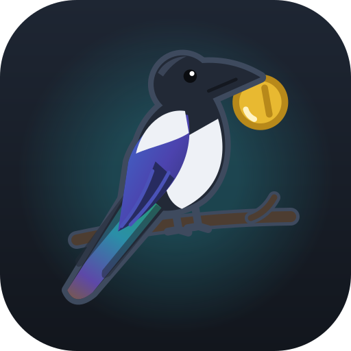

# Brand

| | App icon | Mascot (Maggie) | Idea |
|---|---|---|---|
| **v4** (live) |  |  | A bust: head, bill and coin get the pixels, so it stays crisp at 36px. The icon puts it in front of a pie-chart ring. |
| v3 |  |  | A more realistic Eurasian magpie: iridescent blue-violet wing and green-to-violet tail, dark eye. The icon centres it on a branch. |
| v2 |  |  | Cartoon Maggie; the icon's body is a pie chart. |
| v1 |  |  | First release: a plain bird, and a donut chart icon. |

All versions share the palette: near-black `#262d3a` body with a slate rim `#3e4a5e` so it stays visible on the dark
UI, white `#eef1f6`, teal `#2bb3c0` / `#1d6f8c`, and the gold coin `#e8b931` with its `#b8891a` rim.

v3 and v4 are both in `public/`. To switch the live version (here, to v3), point these at the other files:

- `src/app/Mascot.tsx`: `mascot-v4.svg` → `mascot-v3.svg`
- `index.html` and `vite.config.ts` (`includeAssets` and the manifest's SVG icon): `icon-v4.svg` → `icon-v3.svg`
- then `npm run icons -- icon-v3.svg` to re-render the PNGs iOS and the web manifest use, and update
  `scripts/make-icons.mjs`'s default so the next `npm run icons` keeps it.

The mascot must read at 36px (the Spending header); the icon at 32px.
